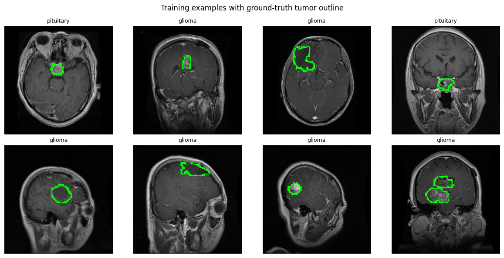
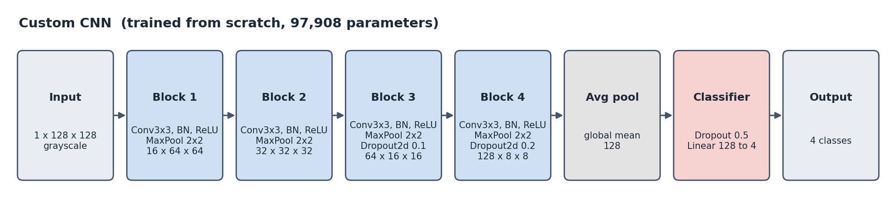
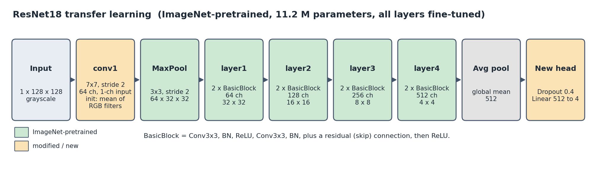
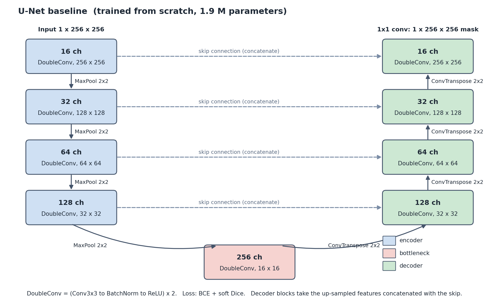
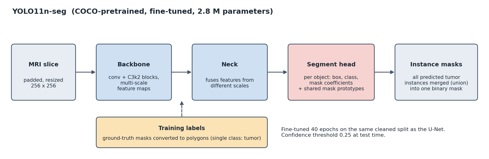
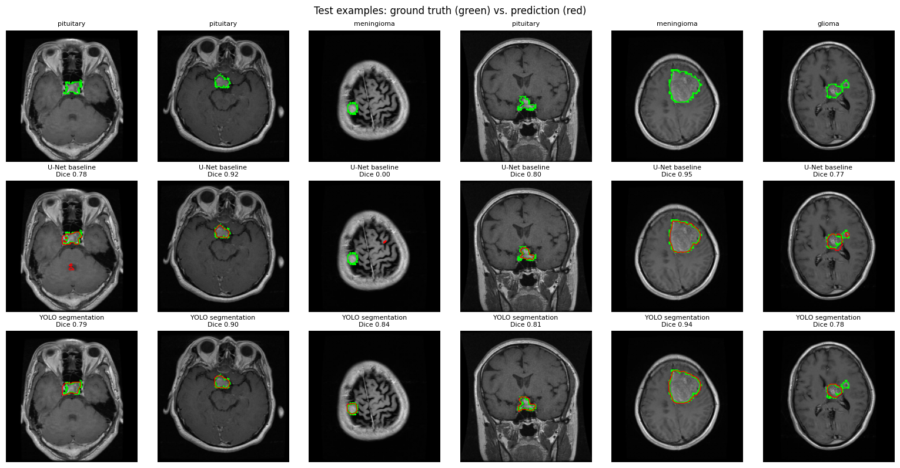
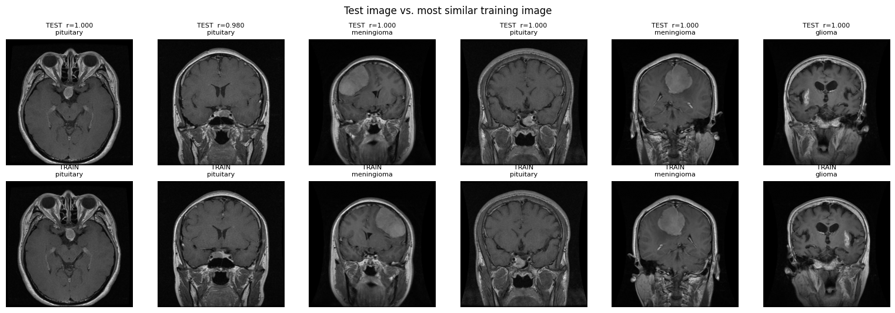

<div align="center">

# BRISC Vision: Brain Tumor Classification and Segmentation

**Two notebooks, four models, one honest evaluation.**
Classifying and segmenting brain tumors in MRI slices, after finding and removing a train/test leak in the official split.


[](https://colab.research.google.com/drive/1LVTJ_JteCDigy8Z38a2vwgshPN6IcHuZ?usp=sharing)
[](https://colab.research.google.com/drive/1tNvPHqEKgHVb7ExRKhUHL0E4EoiLdgwE?usp=sharing)

</div>

---

## Highlights

- **Four models, two tasks:** a small CNN and a ResNet18 for classification, a U-Net and a YOLO11 for segmentation.
- **Data leakage found and fixed:** most test images have a copy in the training set. Removing the copies dropped ResNet18 accuracy from an inflated **99.3% to 93.3%**.
- **Reproducible:** fixed seeds and deterministic GPU mode; every model starts from identical initial weights on each run.

## Dataset

[**BRISC 2025**](https://www.kaggle.com/datasets/briscdataset/brisc2025/data) ([paper](https://www.nature.com/articles/s41597-026-06753-y)) contains 2D contrast-enhanced T1-weighted brain MRI slices in axial, coronal and sagittal planes, with tumor-type labels and tumor masks.

| Task | Train | Test | Labels |
|---|---|---|---|
| Classification | 5,000 | 1,000 | glioma, meningioma, pituitary, no tumor |
| Segmentation | 3,933 | 860 | binary tumor mask (all tumor types merged) |

The data is not stored in this repository; the notebooks download it with `kagglehub`.

<p align="center">
  
  <br><sub>Training slices with the ground-truth tumor outline (green).</sub>
</p>

## Notebooks

| Notebook | Task | Models | Open |
|---|---|---|---|
| `01_classification.ipynb` | 4-class classification | Custom CNN, ResNet18 | [](https://colab.research.google.com/drive/1LVTJ_JteCDigy8Z38a2vwgshPN6IcHuZ?usp=sharing) |
| `02_segmentation.ipynb` | binary tumor segmentation | U-Net, YOLO11n-seg | [](https://colab.research.google.com/drive/1tNvPHqEKgHVb7ExRKhUHL0E4EoiLdgwE?usp=sharing) |

Both follow the same recipe: EDA, duplicate audit, cleaned and group-aware train/validation split, two models, and evaluation on the **official test set**. Model selection uses validation data only.

## Model architectures

### Classification (input: 1 x 128 x 128 grayscale)

**Custom CNN.** Four convolutional blocks that double the channels (16, 32, 64, 128) while halving the resolution, followed by global average pooling and a single linear layer. Small and fast (about 0.1 M parameters), trained from scratch.

<p align="center"></p>

**ResNet18.** An ImageNet-pretrained ResNet18 with two changes: the first convolution takes 1 channel (its weights are the mean of the original RGB filters), and the 1000-class layer is replaced by dropout and a 4-class linear layer. All layers are fine-tuned.

<p align="center"></p>

| | Custom CNN | ResNet18 |
|---|---|---|
| Optimizer | AdamW, lr 1e-3 | AdamW, lr 1e-4 |
| Loss | class-weighted cross-entropy | class-weighted cross-entropy, label smoothing 0.05 |
| Model selection | best validation macro-F1, early stopping (patience 10, max 30 epochs) | same |

### Segmentation (input: 1 x 256 x 256 grayscale, binary mask output)

**U-Net.** A compact encoder-decoder with four down-sampling stages, transposed-convolution up-sampling and skip connections that carry fine detail from the encoder to the decoder (about 1.9 M parameters, trained from scratch).

<p align="center"></p>

**YOLO11n-seg.** A COCO-pretrained Ultralytics instance-segmentation model (about 2.8 M parameters). The ground-truth masks are converted to polygon labels with a single class; at test time, the predicted instance masks of an image are merged into one binary mask so it is scored exactly like the U-Net.

<p align="center"></p>

| | U-Net | YOLO11n-seg |
|---|---|---|
| Optimizer | AdamW, lr 1e-3 | Ultralytics default |
| Loss | BCE + soft Dice | Ultralytics segmentation loss |
| Model selection | best validation Dice, early stopping (patience 10, max 40 epochs) | best validation fitness (Ultralytics), 40 epochs |
| Augmentation | rotation, zoom, flip (not for sagittal) | Ultralytics defaults, flip off |

## Results

All numbers are on the official test sets, **after** removing duplicate training images.

### Classification (1,000 test images)

| Model | Accuracy | Balanced acc. | Macro-F1 | ROC-AUC (macro) |
|---|---|---|---|---|
| Custom CNN | 0.815 | 0.837 | 0.813 | 0.9545 |
| **ResNet18** | **0.933** | **0.943** | **0.932** | **0.9955** |

Transfer learning clearly wins. For both models meningioma is the hardest class, and some meningiomas are predicted as "no tumor". Sagittal slices are the easiest (ResNet18: 0.966 accuracy), axial slices the hardest (0.902).

### Segmentation (860 test images)

| Model | Mean Dice | Mean IoU | Images with Dice < 0.5 |
|---|---|---|---|
| U-Net | 0.786 | 0.686 | 9.9% |
| YOLO11n-seg | 0.788 | 0.688 | 8.5% |

The two models perform practically the same; the 0.002 Dice gap is far below what a single split and seed can resolve. Mean Dice by tumor type (U-Net / YOLO): glioma 0.684 / 0.696, meningioma 0.852 / 0.883, pituitary 0.805 / 0.768. The failure modes differ: the U-Net sometimes adds spurious blobs or misses a tumor, while YOLO returns no detection for about 3% of the images.

<p align="center">
  
  <br><sub>Test examples: ground truth (green) vs. prediction (red).</sub>
</p>

## Duplicate images and data leakage

While exploring the data we noticed that **many test images also appear in the training set**: identical, re-encoded, and even mirrored copies. A model can score well on those just by remembering them, which inflates every metric.

<p align="center">
  
  <br><sub>Test image (top) and its most similar training image (bottom). Several pairs are mirrored copies.</sub>
</p>

**How we measured it.** Each image is padded to a square, shrunk to 32 x 32 and compared by Pearson correlation `r` (`r = 1` means identical up to brightness/contrast; mirrored versions are checked too). Unrelated image pairs have a median `r` of about 0.5, and only 0.02% of them exceed 0.95.

| | Test images with a train copy (`r > 0.95`) | with `r > 0.99` | Train images removed |
|---|---|---|---|
| Classification | 776 / 1,000 (77.6%) | 570 | 1,746 / 5,000 (35%) |
| Segmentation | 730 / 860 (84.9%) | 570 | 1,679 / 3,933 (43%) |

**Why it is not a coincidence.** For matched pairs the class labels agree 99.5% of the time, against 25% expected by chance (classification), and the tumor masks overlap with a median Dice of 0.87, against 0.00 for random pairs (segmentation).

**What we did.** Every training image that matches a test image was removed; the official test set was left untouched. Near-copies inside the training set stay together in the validation split, so validation is not inflated either. Before this cleaning, ResNet18 reached 99.3% test accuracy; afterwards, 93.3%.

> This is a pragmatic cleanup, not a guarantee of patient-level independence: BRISC has no patient IDs, so neighbouring slices of the same patient may remain, and the test scores can still be somewhat optimistic.

## Reproducibility

Seeds are fixed, cuDNN/CUDA run in deterministic mode, and adaptive average pooling is replaced by a plain mean (its CUDA backward pass is non-deterministic). Each model is created right after seeding, and a printed *initial weight checksum* lets you verify identical starting weights. Restart the runtime and use "Run all". YOLO training is seeded and deterministic as far as Ultralytics allows, so tiny differences are possible.

## Quick start

1. Click a Colab badge above and select a GPU runtime (a T4 is enough).
2. Run all cells. The dataset is downloaded automatically with `kagglehub`, and `ultralytics` is installed by the segmentation notebook if needed.

Local setup: `pip install torch torchvision ultralytics kagglehub scikit-learn scipy pandas matplotlib tqdm`

```
.
├── 01_classification.ipynb
├── 02_segmentation.ipynb
├── assets/              # figures used in this README
└── README.md
```

## Limitations

- Image-level evaluation of 2D slices; the scores are not patient-level diagnostic performance.
- One data split and one training run per model; small differences (like U-Net vs. YOLO) are within noise.
- Segmentation is binary (all tumor types merged). The U-Net and YOLO use different training recipes, so the comparison is between recipes, not pure architectures.
- For education and research benchmarking only, **not for clinical use**.

## Reference

Fateh et al., *BRISC: Annotated Dataset for Brain Tumor Segmentation and Classification*, Scientific Data (2026). [Paper](https://www.nature.com/articles/s41597-026-06753-y) · [Dataset](https://www.kaggle.com/datasets/briscdataset/brisc2025/data)
